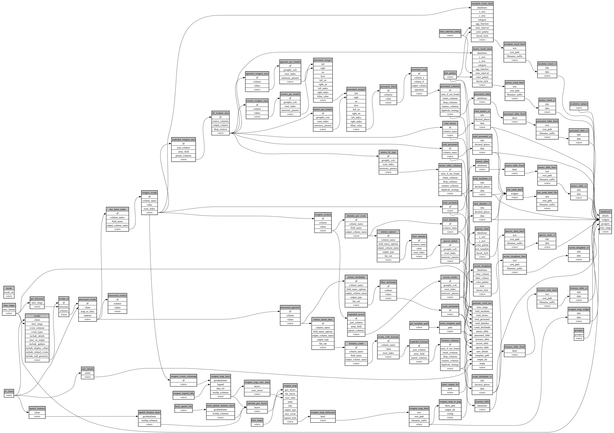

```
# AUTOGENERATED BY ECOSCOPE-WORKFLOWS; see fingerprint in README.md for details

```

```yaml
# fingerprint:
artifacts_sha256_basic: d173b6180255faf7a39ac5d5a2f25ffa7ca23befe4261af99c7c58689eddf1d0
artifacts_sha256_strict: a23fd5ff57c445e466fae09e3454300c08049c7846f2aa9fff09df17b59764ff
installed_requirements:
- channel: https://repo.prefix.dev/ecoscope-workflows/
  name: ecoscope-platform
  version: {version: ==2.28.0}
- channel: https://repo.prefix.dev/ecoscope-workflows-custom/
  name: ecoscope-workflows-ext-custom
  version: {version: ==0.1.0rc23}
- channel: conda-forge
  name: pydeck
  version: {version: ==0.9.2}
- channel: https://repo.prefix.dev/ecoscope-workflows-custom/
  name: ecoscope-workflows-ext-apn
  version: {version: ==0.0.34}
params_sha256: ea9a0ba9a72d5bab929b1078f2702772fe3ddcf4272154a5262f5c4375e1ee9b
spec_sha256: e81971e54f0a362b3350e70c5a881bd9db70b9faa7c96c0a9724c8ec670c3747

```

# ecoscope-workflows-weapon-use-workflow


